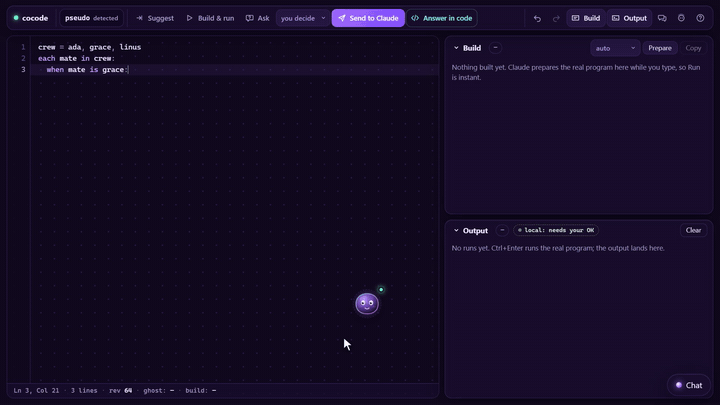
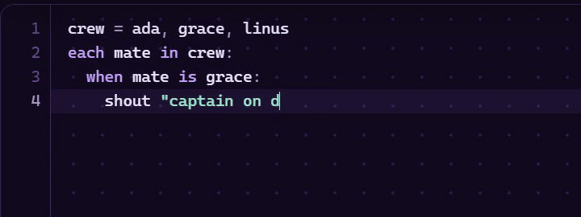
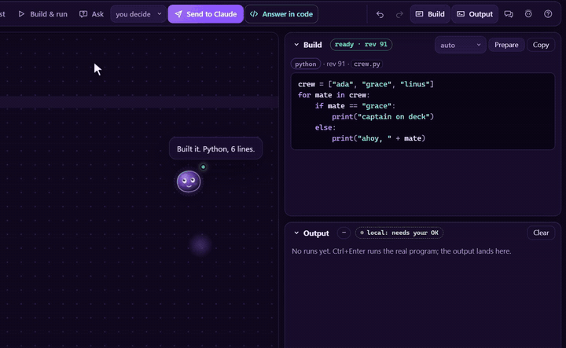

<p align="center"></p>

<p align="center">
  <a href="https://github.com/offensiveadhd/lets-unique-cocode/actions/workflows/validate.yml"></a>
  
  
  <a href="LICENSE"></a>
</p>

<p align="center"><b>Talk in code.</b><br>A <a href="https://github.com/offensiveadhd/lets">lets</a> unique: an editor for any language, even one that doesn't exist. Claude predicts your next lines as a ghost you accept with Tab, prepares the real program in the background so Run is instant, and reads what you send as a question, a task or a note. With your OK, Run executes Python and JavaScript on your machine in milliseconds.</p>

<p align="center">
  <a href="#see-it-run">See it run</a> ·
  <a href="#install">Install</a> ·
  <a href="#what-you-can-do">What you can do</a> ·
  <a href="#run-on-your-machine">Run on your machine</a> ·
  <a href="#reach-what-leaves-the-sandbox">Reach</a> ·
  <a href="#rules-of-the-road">Rules of the road</a> ·
  <a href="#how-claude-drives-it">How Claude drives it</a> ·
  <a href="#layout">Layout</a> ·
  <a href="#develop">Develop</a>
</p>

## See it run

<p align="center">
  <a href="assets/demo.mp4"></a>
</p>

One real take of the cocode window on a real lets host, recorded in a headless browser. The hand types, takes the
ghost with `Tab`, presses **Build & run** and allows the run. Claude's side (the starting points, the ghost, the
build and Doto's lines) is sent through the engine's own tools by a script written ahead, and the output is what
the engine's runner printed on the recording machine. Select the picture for the [full take](assets/demo.mp4),
which goes on to a line that reaches outside the sandbox and to **Send to Claude**. How it was recorded is in
[lets/promo](https://github.com/offensiveadhd/lets/tree/main/promo).

## Install

cocode is installed from the store. It is not a default.

```
/lets store cocode      # inspect → confirm
/lets:lets cocode       # or /lets cocode with the alias
```

Manual: clone this repo into `~/.lets/uniques/cocode`, or set `LETS_UNIQUES_DIRS=<parent folder>` while developing. cocode needs lets 0.4.0 or later (handoff sessions), and 0.7.0 for running on your machine. It asks for no files and no network: the manifest declares `fs.write: []`, `net: []` and `exec: ["python", "javascript", "typescript"]`, the languages it may ask the engine to run for you once you allow it. Engines before 0.7.0 do not know `exec` and reject the manifest.

## What you can do

<p align="center">
  
</p>

| part | what it does |
|---|---|
| **Editor** | Type in any language: a real one, one you made up, or plain pseudo-code. The window never judges it. It detects the language and shows `pseudo` when nothing fits. Click the language chip to name your own. Line numbers, highlighting, auto-indent, an own undo stack. |
| **Ghost** | Claude reads each settled change and offers the next lines as dim, italic text at the caret. `Tab` accepts all of it, `Ctrl+→` one word, `Alt+]` / `Alt+[` cycle the alternatives, `Esc` dismisses. Typing the ghost's first letters shrinks it instead of killing it. When Claude is away, a small local predictor offers weaker ghosts (closers, `else:`, `step 3` after `step 2`), marked *local* in the status line. |
| **Build pane** | While you type, Claude prepares the real program (Python, JavaScript, …) for the current revision. The pane shows the code, its language, the revision and a status. It reads *stale · rev N* when you typed on. A target select (`auto`, `python`, `javascript`, …) and **Prepare** ask for a build now. |
| **Build & run** | One button (`F5`, `Ctrl+Enter`) for both: a ready build in a language your machine runs executes at once; a build Claude is still writing is run the moment it lands; anything else goes through Claude, who builds first and then runs. `Shift+F5` asks Claude for a fresh build before the run. The button's icon is the **wheel**, which says where the job is. |
| **Output pane** | Output streams in, newest run first, with an exit pill (ok, failed, timeout, output cap) and the time it took; a badge in the header says what runs on your machine (`local: python · javascript`). A run with no output for 60 s says *no answer yet*. Claude's notes on your lines list here too. |
| **Reach** | A line that asks for what no sandbox can do (`ping('google.com')`, `claude.browser('https://…')`, `research('…')`, `search('…')`, `agent('…')`, `$ ls`, or the real `requests` / `subprocess` calls) gets a cyan diamond in the gutter, and **Run** goes through Claude, who does it for real with his own tools (the real ping, the browser pane, a web search, a research agent, the shell) and streams what happened. Never a function that prints what a ping *would* say. |
| **Ask** | `Ctrl+K` opens a one-line question about the current line or selection. Or write a line that starts with `??` and press `Enter`: the line stays in your code, and Claude answers in chat and annotates the lines it cites. |
| **Send to Claude** | Hands the code over as a message. Pick what you mean (*you decide*, *a question*, *explain this*, *do this*, *fix this*, *review this*, *just a note*) or leave it on auto. The window closes and Claude answers in Claude Code. Say *continue* to bring it back with your code, build, runs and notes. |
| **Answer in code** | Next to it (`Ctrl+Shift+O`, also in Doto's menu): the same handoff, but Claude's whole answer comes back written as code in the chip's language, nothing else. Without a window: `/lets cocode output [lang] <question>`. |
| **Seeds** | An empty editor shows starting points: Claude's (from memory and saved sessions), then your last ten recents. Pick one, or just start typing. |
| **Keyboard** | Everything is reachable with Tab, every control has a name, and `?` lists the shortcuts. |

<details>
<summary>The wheel: what the Build & run button shows</summary>

The button's icon is the state of the job, build and run together.

| the icon | means |
|---|---|
| the play triangle | idle |
| a spinning ring | building or running (a slow amber ring while a run waits for Claude because Doto is away) |
| ✓ | the last run of this text passed |
| ✗ | it failed |
| ? | nothing answered for 60 s |

The tab title carries the same mark. An edit puts it back to idle. Under reduced motion the ring is dashed and does not spin.

</details>

<details>
<summary>Every key</summary>

The editor has the focus unless the row says otherwise.

| key | does |
|---|---|
| `Tab` | accepts the ghost; otherwise inserts two spaces, or indents the selected lines |
| `Shift+Tab` | outdents |
| `Ctrl+→` | accepts the ghost's first word |
| `Alt+]` / `Alt+[` | next / previous alternative |
| `Esc` | dismisses the ghost, then closes the innermost open thing (consent card, help, ask form, note, empty state) |
| `Alt+\` | asks for a ghost now |
| `Enter` | a new line with the current indentation, one level deeper after a line ending in `:`, `{` or `(`; on a `??` line it also asks |
| `F5` / `Ctrl+Enter` | builds and runs; `F5` works anywhere in the window and never reloads the page |
| `Shift+F5` | rebuilds with Claude first, then runs |
| `Ctrl+K` | Ask |
| `Ctrl+Shift+Enter` | sends to Claude |
| `Ctrl+Shift+O` | Answer in code |
| `Ctrl+Z` / `Ctrl+Y` | undo and redo (an own stack of 200 steps) |
| `Ctrl+D` | duplicates a line, or the selection |
| `Alt+↑` / `Alt+↓` | move it |
| `Ctrl+;` | comments it; again to uncomment |
| `Ctrl+B` / `Ctrl+J` | toggle the Build and Output panes |
| `Ctrl+M` | toggles *Tab moves focus*, so the keyboard can leave the editor |
| `Ctrl+/` | chat with Claude |
| `Ctrl+Space`, right-click | call your companion |
| `?` (outside the editor) | the shortcuts overlay |
| `1` / `2` (outside the editor) | focus the editor / the Output pane |

</details>

<details>
<summary>The languages the window detects</summary>

`python`, `javascript`, `typescript`, `go`, `rust`, `bash`, `sql`, `c`, `cpp`, `java`, `ruby`, `html`, `css`, `json`. Anything else shows as `pseudo`. A name you type on the chip is free text: 1 to 24 characters, lowercase letters, digits and `+ # . - _` (`my-lang`).

</details>

## Run on your machine

<p align="center">
  
</p>

With lets 0.7.0, Run does not wait for Claude when the program is Python, JavaScript or TypeScript: the engine runs it on your computer and the output arrives in milliseconds. The first time, the window asks **Run on this machine?** and says what that means; nothing runs until you press **Allow on this machine**, and the engine (not the window) remembers that for cocode. **Not now** sends that run to Claude, as before.

**What is sandboxed.** Each run gets a fresh temporary folder under `~/.lets/run/jobs` (deleted afterwards), a scrubbed environment, 30 s and 1 MB of output.

| language | runs under | which blocks |
|---|---|---|
| Python | an audit hook | files outside that folder, sockets and subprocesses |
| JavaScript and TypeScript | Node's permission model | files outside that folder and child processes |

**What is not.** It runs as you and is not a VM, CPU and memory are not capped, and **Node does not block the network**.

When you type Python or JavaScript yourself, the window runs your text *as written*; Claude only sends a build when it improves on it (sample data, a fix). Claude's own runs are not affected: they still go through Claude Code's permission prompt. Switch it off with `"runner": {"enabled": false}` in `~/.lets/config.json`. The engine's side of this is in [docs/RUNNER.md](https://github.com/offensiveadhd/lets/blob/main/docs/RUNNER.md) in the lets repo.

## Reach: what leaves the sandbox

A sandbox can print and compute. It cannot ping a host, open your browser, search the web, start a research agent or run a shell command, and before 0.3.0 a line like `ping('google.com')` quietly became a `ping` function that printed what a ping would have said. Now such a line is a **reach**, and Claude does it for real.

Write it any way you like, in any language:

```
ping('google.com')                  # a bare verb: ping, dns, fetch, curl, browser, search, research, agent, hermes, shell, say, ask
claude.browser('https://example.com')   # the claude namespace: any verb, claude.whatever(...) included
ping: google.com                    # pseudo-code, no parentheses, any separator or bracket: (ping "google.com"), PING -> google.com
go to https://example.com           # natural phrases: open google.com, search the web for …, find out who maintains lodash,
spawn an agent to review the repo   #   investigate …, agent: …, hermes …, shell: ls, run the command dir, notify me when done
claude, research the history of morse code   # Claude by name: the next word is the verb (ask claude to …, claude: open https://…)
$ dir                                # a shell line
r = requests.get(url)                # the real library the sandbox would block (python: requests, socket, subprocess, os.system, webbrowser…)
```

The window's scan is a hint. Your language may phrase a reach in words no regex knows (`pingen google`), so Claude also reads the program for reaches himself and treats one he finds exactly like a listed one. And the build goes on as before: Claude still works out what the real program looks like in the Build pane, whatever your dialect, writing each reach as `claude.<verb>(…)` so you can see what he will do.

**In the window.** Each reach gets a small cyan diamond in the gutter. Hover it and a note names the reach and what it reaches (for `ping google.com`, the network), and says that Claude does it for real when you Run. The status line counts them.

**When you press Run.** Run skips the local runner whatever the language:

- the run entry gets a `reach · N` badge;
- Claude performs each reach in the program's order with the matching tool (the real `ping`, the app's browser pane with the tab left open for you, a web search, a sub-agent, the local Hermes agent, Bash, the chat);
- he names each one in cyan as he goes (`→ ping google.com`), and streams the real output;
- the pure parts of the program still run in the sandbox.

A reach that would change the world (send, post, delete, pay) waits for your yes in chat; probing someone else's security is refused. Claude Code's own permission prompts stand for every tool he calls.

**Not a reach:** a comment, a `??` line, a function you defined yourself (`def ping(host):` makes `ping(…)` yours), a method of the same name (`re.exec`, `list.search`), and what the language's sandbox does itself (`fetch` in JavaScript runs locally, since Node's permission model allows the network). The scanner is a heuristic: a reach it misses in Python ends with `RuntimeError: blocked by the lets sandbox`, and Claude reads that as a reach and performs the program for real.

## Rules of the road

- A ghost is an offer. It is not in your document until you accept it, and `Ctrl+Z` takes an accepted one back.
- Your language wins. Claude does not rewrite your pseudo-code into a real language in the editor. The real program lives in the Build pane.
- cocode stores nothing on the host. The code lives in the window, in a saved session after *Send to Claude*, and in `sessionStorage` for this tab so a reload keeps it. Preferences and your last ten recents sit in `localStorage`.
- If the host is not connected, the editor still works. Run, Ask and Send need a host.
- If Claude is not listening, a run on your machine still happens at once. A run that goes through Claude still opens its entry, and the window says Doto is away. It starts with your next message in Claude Code.

## How Claude drives it

<p align="center"></p>

Events (up): `cocode.changed`, `cocode.ghost.accept|reject|request`, `cocode.build.request`, `cocode.run` (Claude builds if needed and runs; with `reach`, he performs each reach for real; with `rebuild`, he builds anew first), `cocode.ran` (the window ran it on your machine), `cocode.ask`, `cocode.export`, `cocode.snapshot`.
Commands (down): `cocode.suggest`, `cocode.seed`, `cocode.build`, `cocode.output`, `cocode.insert`, `cocode.replace`, `cocode.set`, `cocode.lang`, `cocode.annotate`, `cocode.highlight`, `cocode.focus`, `cocode.load`, `cocode.snapshot`.

<details>
<summary>Every event, and when the window sends it</summary>

| event | sent when |
|---|---|
| `cocode.changed` | The text settled (500 ms after the last keystroke). It carries the revision, the text, the language, the caret, the caret line so far (`prefix`) and who changed it (`by`: `human`, `claude` or `restore`). |
| `cocode.ghost.accept` | You accepted a ghost with `Tab`, or one word of it with `Ctrl+→` (`partial`). |
| `cocode.ghost.reject` | You dismissed a ghost of Claude's: `esc`, `typed-away` or `moved`. |
| `cocode.ghost.request` | You pressed **Suggest** (`Alt+\`) or picked it from Doto's menu: a ghost is wanted now. |
| `cocode.build.request` | You picked a target language in the Build pane or pressed **Prepare**. |
| `cocode.run` | Build & run, not run here. It carries the latest build if there is one, the reaches when there are any, and `rebuild` after `Shift+F5`. |
| `cocode.ran` | The window ran the build on your machine: the exit code, the time, the sandbox, and the last 4 000 characters of stdout and stderr. |
| `cocode.ask` | A question with the code: from **Ask**, from a `??` line ended with `Enter`, or from Doto's menu. |
| `cocode.export` | **Send to Claude** or **Answer in code**: the handoff, with the intent, the code, the build, the last runs, the notes, and how many ghosts you accepted and rejected. |
| `cocode.snapshot` | The answer to the `cocode.snapshot` command: the export payload without an intent. |

</details>

<details>
<summary>Every command, and what the window does with it</summary>

| command | effect |
|---|---|
| `cocode.suggest` | Shows the next lines as a ghost at the caret. Up to 12 lines; an empty text clears it. A ghost for an older revision shows only while the text before the caret still matches. |
| `cocode.seed` | Starting points for an empty editor, at most 6. |
| `cocode.build` | The real program for a revision, with a status: `building`, `ready` or `failed`. It always replaces the window's own as-written build. |
| `cocode.output` | Run output on one of four streams: `stdout`, `stderr`, `system` or `reach`. `done` with an exit code closes the run. |
| `cocode.insert` | Inserts text at a position, at the cursor or at the end. Animated and undoable. |
| `cocode.replace` | Replaces a range of lines. Animated and undoable. |
| `cocode.set` | Replaces the whole document. Undoable, and Claude asks first. |
| `cocode.lang` | Sets the language chip. |
| `cocode.annotate` | A gutter marker with a floating note on a line: `note`, `ok`, `warn` or `error`. |
| `cocode.highlight` | Glows a range of lines, for 4 s unless told otherwise. |
| `cocode.focus` | Scrolls a line into view and puts the caret there. |
| `cocode.load` | Restores a document with its build, runs and notes. This is the resume command. |
| `cocode.snapshot` | Asks the window for its state. It replies with the `cocode.snapshot` event. |

</details>

The manifest's `session` block (`export: cocode.export`, `snapshot: cocode.snapshot`, `restore: cocode.load`) lets the engine save a handoff and resume it.

- [GUIDE.md](GUIDE.md) is what Claude reads when it opens cocode: the predict loop, build ahead, how to run a program and stream its output, what to do for each kind of reach, how to read a handoff, the etiquette.
- [CONTRACT.md](CONTRACT.md) is the behaviour spec: the model, every event and command with its data, the flows, the page, the local predictor, the local runner and reach (§10).
- `schemas/` holds JSON Schemas for the main messages: `changed`, `run`, `ran`, `ask`, `export`, `suggest`, `build`, `output` and `load`.

## Layout

```
unique.json    LIP manifest (name, entry, domains, events, commands, session, permissions incl. exec)
GUIDE.md       instructions for Claude
CONTRACT.md    behaviour spec
icon.svg
assets/        what this README shows: banner.svg, flow.svg, demo.gif, demo.mp4 (the full take), ghost.gif, run.gif
schemas/       changed, run, ran, ask, export, suggest, build, output, load; unique.schema.json (vendored)
ui/            index.html, cocode.js (the window), editor.js (textarea, highlight layer, ghost, undo),
               syntax.js (tokenizer, language detection), predict.js (local predictor),
               reach.js (the lines that reach outside the sandbox), style.css
scripts/       validate.mjs: manifest + schema check (zero dependencies)
test/          reach.test.mjs: node --test (zero dependencies)
```

The UI imports the engine's SDK at runtime (`/sdk/lets-client.js`, `/sdk/lets-shell.js`). It has no build step and no dependencies, and it never runs your code in the page: the engine's local runner does (after your OK), or Claude does, and the output streams back.

## Develop

```bash
# from a lets checkout; the registry looks for <dir>/cocode/unique.json,
# so point it at the PARENT of a folder named "cocode" (symlink or junction this repo there)
LETS_UNIQUES_DIRS=/path/to/parent node engine/bin/lets.mjs serve --open cocode --verbose

node engine/bin/lets.mjs send cocode.suggest '{"rev":1,"text":"print(x)"}'   # drive it from the CLI
node engine/bin/lets.mjs events                                              # drain what cocode emitted
```

Validate with `node scripts/validate.mjs` here, or `node engine/bin/lets.mjs validate <this folder>` from the engine.

## License

MIT © offensiveadhd
